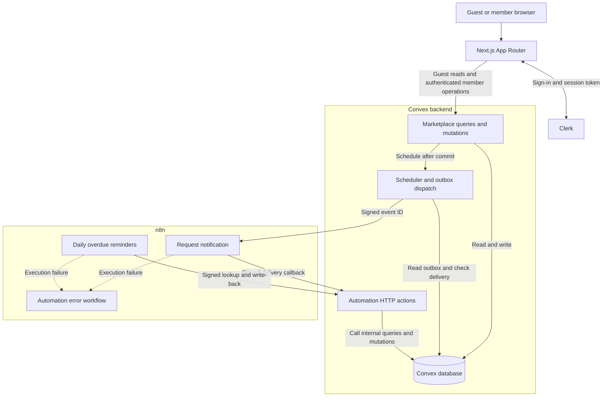
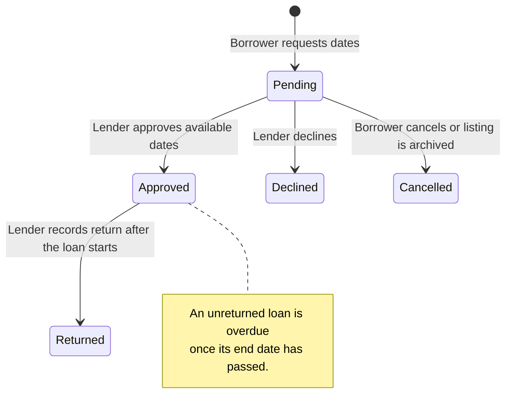
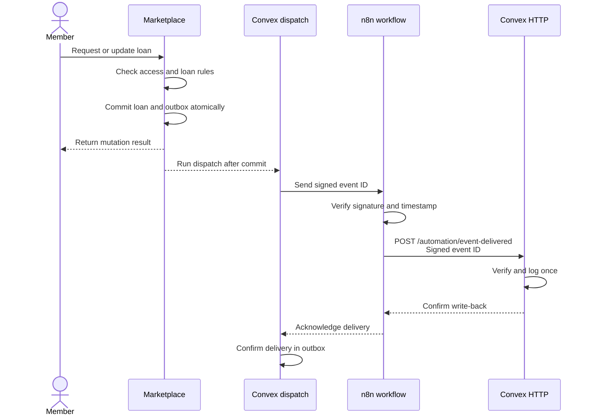
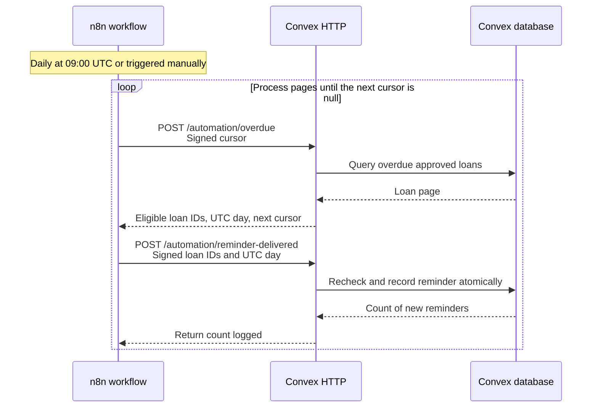
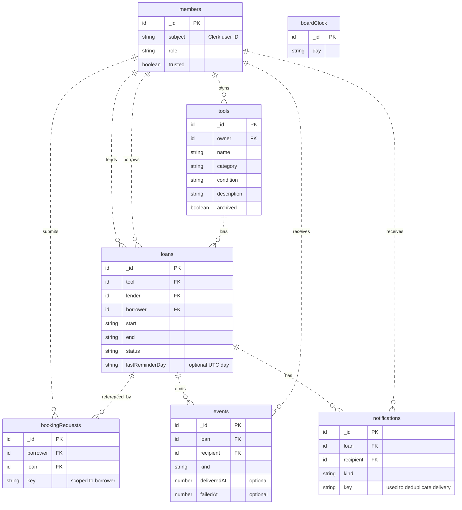

# LendLoop

**Borrow what you need. Lend what you don’t.**

LendLoop is a neighborhood tool-lending board built for the Fluence full-stack take-home. Guests see the names and categories of tools available to borrow. Signed-in neighbors can lend tools, request dates, and track loans. n8n coordinates request notifications and overdue reminders, visible in each recipient’s Activity view.

[Run locally](#run-from-a-fresh-clone) · [Demo walkthrough](#walk-through-the-demo) · [Architecture](#architecture)

## Run from a fresh clone

You’ll need Docker Compose, a Clerk development application, and a supported Node.js runtime
(22.18+, 24.11+, or 26+ as specified in `package.json`) with npm 11.17. The walkthrough below uses
local Convex and Docker n8n. All data and accounts used for the demo should be disposable.

### 1. Install and configure Clerk

```sh
git clone https://github.com/MohamedArbani/LendLoop.git
cd LendLoop
npm ci
cp .env.example .env.local
cp n8n/.env.example n8n/.env
```

Create a development application in the [Clerk dashboard](https://dashboard.clerk.com).
In **JWT templates**, create a template from the **Convex** preset and keep the template name
and audience as `convex`. Copy the development publishable and secret keys into `.env.local`.
Save the JWT template’s **Issuer** URL for the next step.

### 2. Start Convex

```sh
CONVEX_AGENT_MODE=anonymous npx convex dev
```

Leave the watcher running. It creates the local deployment and fills in
`NEXT_PUBLIC_CONVEX_URL` in `.env.local`. Its first push may report a missing Clerk issuer.
In another terminal, set the issuer and the Convex webhook URL.

```sh
npx convex env set CLERK_JWT_ISSUER_DOMAIN 'https://YOUR-INSTANCE.clerk.accounts.dev'
npx convex env set N8N_REQUEST_WEBHOOK_URL 'http://127.0.0.1:5678/webhook/lendloop-request-event'
```

Generate three independent values with `openssl rand -hex 32`. Set each one in the locations below.
Use the same value on both sides for each signing direction. Run
`npx convex env set CONVEX_TO_N8N_SECRET` and `npx convex env set N8N_TO_CONVEX_SECRET` to enter
the keys interactively.

| Where | Variable | Value |
| --- | --- | --- |
| `.env.local` | `NEXT_PUBLIC_CLERK_PUBLISHABLE_KEY` | Clerk development publishable key |
| `.env.local` | `CLERK_SECRET_KEY` | Clerk development secret key |
| `.env.local` | `NEXT_PUBLIC_CONVEX_URL` | Convex client URL, normally written by the CLI |
| Convex | `CLERK_JWT_ISSUER_DOMAIN` | Issuer URL from the Clerk JWT template |
| Convex | `N8N_REQUEST_WEBHOOK_URL` | Full request webhook URL on n8n |
| Convex and `n8n/.env` | `CONVEX_TO_N8N_SECRET` | Request event signing key |
| Convex and `n8n/.env` | `N8N_TO_CONVEX_SECRET` | Separate signing key for lookups and write-backs |
| `n8n/.env` | `N8N_ENCRYPTION_KEY` | Independent n8n credential encryption key |
| `n8n/.env` | `CONVEX_SITE_URL` | `http://host.docker.internal:3211` for Docker Desktop |
| `n8n/.env` | `WEBHOOK_URL` | `http://localhost:5678/` for local n8n |

The local Convex client uses port 3210 and HTTP actions use port 3211 by default.
On Linux Docker Engine, map `host.docker.internal` to `host-gateway` through the Compose
service’s `extra_hosts` setting if the hostname is unavailable. Adjust the URLs if you use
different ports.

### 3. Import and publish the n8n workflows

```sh
docker compose up -d
```

1. Open [the n8n editor](http://localhost:5678) and create a local owner account.
2. Run `docker compose exec n8n n8n import:workflow --separate --input=/workflows`. Refresh the editor
   to see the three workflows.
3. Publish **LendLoop · Automation errors** first. In the settings for the request and overdue workflows,
   set **Error workflow** to **LendLoop · Automation errors**, then publish both workflows.
4. Run `npm run dev` in a separate terminal and open [LendLoop](http://localhost:3000).

The Compose profile runs a dedicated single-owner n8n instance. Its HMAC Code nodes read environment
variables through `$env`. Keep workflow editing limited to the trusted owner. The mock notification
uses the app’s Activity inbox and requires no mail or chat provider.

On subsequent starts, run `docker compose up -d`, `npx convex dev`, and `npm run dev`.
After editing `n8n/.env`, recreate the container with `docker compose up -d --force-recreate n8n`.
The Docker volume keeps workflows and execution history.

#### Hosted Convex alternative

Initialize `npx convex dev` with your own development project instead of anonymous mode.
Set `CONVEX_SITE_URL` in `n8n/.env` to the hosted `.convex.site` URL. If n8n is on your machine,
use an HTTPS tunnel or reverse proxy that forwards only `POST /webhook/lendloop-request-event`.
Put the public HTTPS base URL in `WEBHOOK_URL` and the complete HTTPS webhook URL in
Convex’s `N8N_REQUEST_WEBHOOK_URL`. Keep the editor on localhost. The webhook must use
`/webhook/`, which is active after publishing.

### Walk through the demo

1. Sign in as a lender and list a tool. In a separate guest session, confirm that the catalog
   shows the tool’s name and category.
2. Sign in as a borrower in a separate browser profile and request today through tomorrow.
   Check the lender’s **Incoming requests** and **Activity** views for the new request. The Activity
   entry confirms the signed n8n callback recorded the notification. To show the successful run in
   n8n’s **Executions** tab, temporarily enable saving successful production executions for the demo.
3. Approve the request. Check that it appears under the borrower’s **My requests** and **Activity**,
   and that the tool disappears from the guest catalog. Mark the loan returned as the lender.
   Confirm that the guest catalog lists the tool again and the borrower gets a return notification.
4. For the overdue check, approve a separate loan. In the Convex data dashboard for your disposable
   deployment (`npx convex dashboard`), set that loan’s `start` and `end` to yesterday’s UTC date
   in `YYYY-MM-DD` format. Keep the loan approved. Run **LendLoop · Daily overdue reminders**
   manually from the editor. Verify that the borrower gets one reminder in **Activity** and that
   the loan shows its latest reminder date. Run the workflow again on the same UTC day and verify
   there is still one reminder. Mark the loan returned after the demo.
5. To check admin access, sign in with a third account. Promote its Clerk user ID from the Convex CLI,
   then check **All loans**, moderation, and the **Trusted Lender** badge. Use `"role":"user"` to
   revoke the role afterward.

   ```sh
   npx convex run members:setRole '{"subject":"user_REPLACE_WITH_CLERK_ID","role":"admin"}'
   ```

## Browser tests

Install Chromium and run the guest and offline checks.

```sh
npx playwright install chromium
npm run test:e2e
```

Run the signed-in tests with development Clerk keys and a disposable Convex deployment configured in `.env.local`. Keep the published n8n request workflow running with its signed Convex callback configured. The tests verify delivered Activity entries. They create and delete temporary Clerk users. Convex retains the test loan history and archived listings.

```sh
E2E_AUTH=1 npm run test:e2e
```

Set `E2E_CONVEX_ADMIN_KEY` for that same Convex deployment to include the administrator test. Set `E2E_BASE_URL` to run the selected suite against an already running app, such as a local production build.

## Architecture

### System overview



The Next.js proxy routes signed-in traffic to `/dashboard`. Cache Components prerender the public shell and dashboard loading state. The dashboard streams an authenticated snapshot of the first tool page and board overview. Convex subscriptions keep the visible page current. The public library, dashboard listings, loan tabs, and Activity load one page at a time. A browser-wide page-size preference offers 10, 25, 50, or 100 items. Controls appear when a list has at least 10 items or another page can be reached. Overview counts use bounded reads and show a plus sign when the displayed count is a lower bound. Next.js uses its `seconds` cache profile for the public catalog, which lists available tools and exposes only their names and categories in each catalog item.

### Loan lifecycle



Loan dates are inclusive UTC calendar days. An approved booking blocks overlapping dates, and approval checks availability in the same transaction that changes the loan state. A future booking leaves the tool available today. When a return is overdue, members can request future dates and lenders can approve once the tool is returned. Request keys are scoped to the authenticated borrower and replay the original request even if its status has changed. Archiving a listing preserves loan history, and lenders can still mark its approved loans returned.

### Request notification sequence



The event determines which member sees the notification in Activity. If the webhook fails or the write-back is missing, Convex retries delivery. When retries run out, the loan shows a delivery failure.

### Overdue reminder sequence



Convex skips a loan returned between lookup and write-back. It also skips loans that already received a reminder that UTC day.

### Convex data model

The arrows show document ID references from [the Convex schema](convex/schema.ts). `boardClock` is a standalone record refreshed at midnight UTC so availability subscriptions update as the day changes.



### Security, data minimization, and reliability

- **Enforcement.** Convex verifies Clerk’s JWT and maps it to a server-owned member record. New accounts always start as users. Admins may moderate any listing, read all loans, and award a badge. Loan transitions still require lender or borrower participation. Direct Convex calls receive the same checks as the UI.
- **Data boundaries.** Guest catalog items contain only the names and categories of available tools. Signed-in borrowers receive booked date ranges for a selected tool without participant details. Convex keeps the mapping between internal recipients and Clerk identities. The n8n request webhook receives an opaque event ID. The overdue workflow receives opaque loan IDs, the UTC day, and a pagination cursor. Neither workflow needs a name, email address, tool description, or Clerk user ID.
- **Signed transport.** Both directions authenticate the route scope, millisecond timestamp, and exact payload bytes using HMAC-SHA-256 and separate secrets. The request webhook signs the inner JSON string so the signature survives n8n’s outer JSON parsing. n8n signs the raw callback body and the Convex HTTP action verifies it. Receivers reject invalid signatures and timestamps outside five minutes. Write endpoints also resolve IDs and check eligibility server-side.
- **Idempotent delivery.** A request event ID or loan ID plus UTC day keys the mock notification. Convex writes each notification and its delivery status in one transaction. A repeated callback logs no second notification. Reminder writes recheck the date and status, so a loan returned after the read is skipped. Successful scheduler acknowledgement requires a recorded delivery.
- **Failures.** Convex attempts request delivery four times with 10-second, 1-minute, and 5-minute backoffs. n8n retries callback HTTP requests three times in total, retains failed executions, and records scheduled and webhook failures via its error workflow. The loan UI shows a terminal request-notification failure. After correcting configuration, an operator can rerun the internal `dispatch:send` action with `{"eventId":"…","attempt":1}` for a failed event from the Convex dashboard or CLI. Rerunning an overdue execution safely catches up on the current UTC day.

### What I would change for production

Move automation signing keys to a managed secret store and into a dedicated signing node or worker with rotation support and tighter editor permissions. Encrypt and restrict execution data, set explicit retention, alert on dead letters or missed reminder runs, and give operators audited replay controls. Replace the mock inbox with a notification provider that accepts a stable idempotency key or supports reconciliation after ambiguous delivery. Add tenant-scoped authorization, audit trails, rate limits, and load tests for simultaneous approvals. For a healthcare deployment, review access, retention, vendor agreements, and data flow against the applicable requirements before moving any patient data through an integration.

## Checks

```sh
npm run check  # Vite+ checks, Next.js ESLint, and TypeScript
npm test       # Convex and workflow integration tests
npm run build  # Next.js production build
```

Vite+ runs the integration tests and linting. Next.js runs the app and builds it for deployment.
See [Browser tests](#browser-tests) to run Playwright with or without development services.

The integration tests use Convex’s in-memory runtime and execute the checked-in n8n Code node source against real Convex HTTP handlers in that runtime. They cover public fields, RBAC, overlapping approvals, signature verification and replay, retries, pagination, and returns that race reminder delivery. The manual walkthrough exercises Clerk JWT exchange with your configured Clerk instance.

Setup references: [Convex and Clerk](https://docs.convex.dev/auth/clerk), [n8n workflow CLI](https://docs.n8n.io/hosting/cli-commands/), [n8n task runners](https://docs.n8n.io/hosting/configuration/task-runners/).
